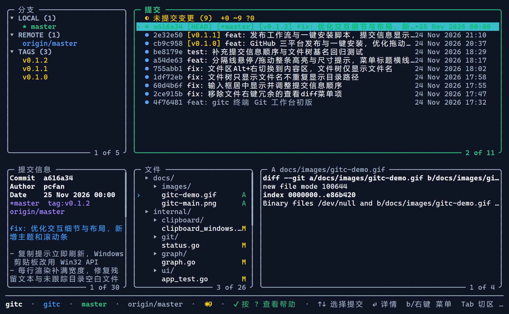
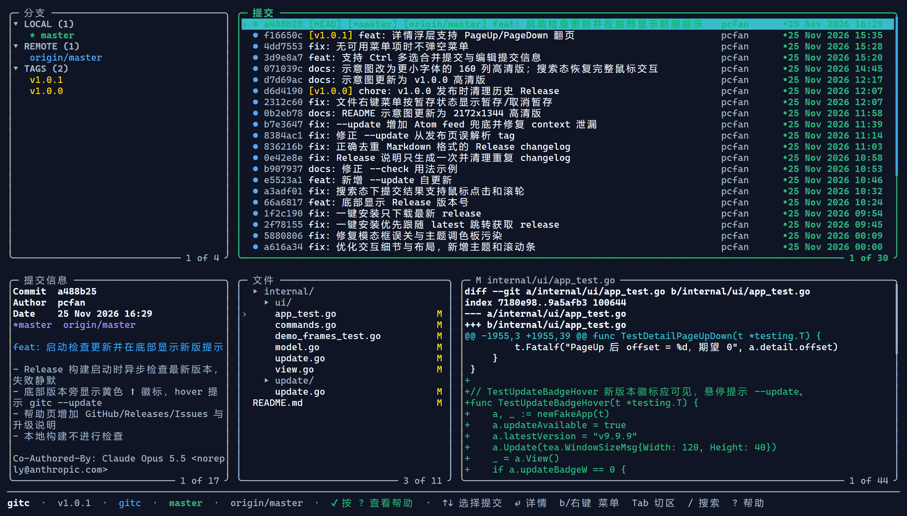

# gitc — 终端里的 Git 工作台

`gitc` 是一款终端交互式 Git 客户端：在仓库目录执行 `gitc`，即进入全屏工作台——左上项目区与分支、左下提交信息，右侧提交图、文件 diff 与命令历史。键鼠皆可操作，危险操作二次确认。

- **快**：Go 单二进制，流式加载提交历史；1 万提交仓库首帧 < 50ms。
- **好用**：右键菜单浮在当前界面之上（支持 hover/点击）；分支/当天提交/HEAD 有明显标记；命令历史只记录你主动触发的操作；内置多套主题并支持自定义语义色。
- **跨平台**：Windows / macOS / Linux，仅依赖系统 `git`（>= 2.23）。

## 界面预览



提交右键菜单、行内搜索、提交详情、复制提示：



## 安装（一条命令，自动配置 PATH）

Linux / macOS：

```bash
curl -fsSL https://raw.githubusercontent.com/ssk-wh/gitc/master/install.sh | bash
```

Windows（PowerShell）：

```powershell
powershell -NoProfile -ExecutionPolicy Bypass -c "irm https://raw.githubusercontent.com/ssk-wh/gitc/master/install.ps1 | iex"
```

脚本会从 GitHub Releases 下载最新版本对应平台的二进制，校验 SHA256，安装到 `~/.local/bin`（Windows 为 `%LOCALAPPDATA%` 下的 gitc 目录）并写入 PATH。可用 `GITC_VERSION` 指定版本、`GITC_MIRROR` 指定镜像。

其他方式：

```bash
go install github.com/ssk-wh/gitc@latest   # 需要 Go 1.22+
```

或本地构建：

```powershell
build/build.ps1     # Windows
build/build.sh      # macOS / Linux
```

每次推送 `v*` tag 时，GitHub Actions 会自动构建 Windows / macOS / Linux（amd64 + arm64）并发布到 Releases。

## 使用

```bash
cd 任意git仓库
gitc                # 进入交互工作台
gitc -C /path/repo  # 指定仓库
gitc --lang zh      # 中文界面（默认跟随 LANG / 系统语言）
gitc --theme ocean  # 主题：default / light / ocean / forest / fire / rose / high-contrast
gitc --update       # 检测最新 Release 并自动下载安装（/usr/bin 下需 sudo）
gitc --check        # headless：输出仓库摘要后退出（CI/脚本）
gitc --version
```

## 界面

lazygit 风格工作台：每个区域一个完整边框，左上角中文标题、右下角显示 `x of y` 计数，焦点区域边框为绿色。

- 左栏三块：项目、分支、提交信息；右侧四块：提交、工作区文件、内容、命令日志（无操作记录时隐藏）。工作区改动在提交列表首行“未提交变更”，进入文件区即可暂存/丢弃。
- 多项目：左上角独立“项目”区域按“项目名 + 当前分支”两列对齐显示，点击或回车切换；右键该区域标题可“添加项目…”，调用系统目录选择框（不可用时回退内置选择器）。添加/移除项目会写入当前仓库的 `.gitc-workspace`，下次打开优先读取；切回已打开过的项目会先渲染缓存，再后台刷新校验。项目存在多个 worktree 时默认展开子列表，可选中 worktree 查看其未提交改动，右键可新建/移除 worktree；项目右键可移除项目（移除当前项目会自动切到剩余项目）。
- 顶部不再有全局 header；底部左侧显示版本（Release 构建）与操作提示，右侧贴右显示快捷键说明，宽度不足时左侧自动省略。
- 提交选中行整行背景高亮；提交按作者日期倒序，时间格式 `17 Nov 2026 17:15`（当天带 `•`）。
- 提交信息头部固定为 `Commit / Author / Date` 两列对齐，下面显示引用、标题与正文。
- 外部 git 变化（tag/分支/提交）每 3 秒自动检测并刷新；worktree 列表约 15 秒刷新。
- 启动自动检查新版本：有新版本时底部出现黄色 `⬆ vX.Y.Z` 徽标，鼠标悬停提示运行 `gitc --update` 升级。
- 帮助页（`?`）包含 GitHub 源码、Releases 与 Issues 地址。
- 提交行同时显示分支与 tag 徽标：tag 黄色，分支按最近提交时间分配 20 种颜色。
- 可滚动区域右侧边框显示 lazygit 风格滚动条；悬停分隔线显示拖动手柄，分隔线位于区域间空白并可拖动持久化。

## 键位

| 键 | 行为 |
|----|------|
| `↑/↓` | 当前区选择/滚动（统一使用方向键） |
| `PgUp/PgDn`、`Ctrl+U/D` | 翻页；内容区整页滚动 |
| `Home/End`、`g/G` | 首尾 |
| `Tab` / `Shift+Tab` / `←` `→` | 七区循环：项目 → 分支 → 提交信息 → 提交 → 文件 → 内容 → 命令历史 |
| `Alt+方向键` | 按空间位置切换区域 |
| `Enter` | 分支检出 / 提交详情 / 文件聚焦内容区 |
| `Space` | 工作区文件区：暂存或取消暂存；目录：展开/折叠 |
| `c` / `A` | 提交 / amend（多行信息，`Ctrl+S` 提交） |
| `a` / `u` | 全部暂存 / 全部取消暂存 |
| `D` | 工作区文件区：丢弃全部未提交改动（二次确认） |
| `f` / `F` | fetch / fetch --prune |
| `p` / `P` | pull / push（无上游时引导设置） |
| `z` / `Z` | stash / 跳到 stash 分组 |
| `v` | 选择提交视图的分支（或点击 COMMITS 标题） |
| `b` 或鼠标右键 | 上下文菜单：分支/分组/提交/文件/未提交改动/命令历史 |
| `C` / `V` / `X` | cherry-pick / revert / reset（soft/mixed/hard） |
| `t` / `y` | 打标签 / 复制 sha 与提交信息（系统剪贴板） |
| `m` / `B` | 分支区：合并到当前 / 当前 rebase 到所选 |
| `d` / `r` / `n` | 分支区：删除 / 重命名 / 新建；工作区文件区：丢弃所选 |
| `o` | 分支区 stash：pop |
| `-` / `+` | 折叠 / 展开当前分组 |
| `M` | 冲突态 continue / abort |
| `/` | 行内搜索：实时过滤 hash/提交信息，`Enter` 搜全部历史 |
| `:` | 透传任意 git 参数 |
| `T` | 切换主题（default / light / ocean / forest / fire / rose / high-contrast） |
| `L` / `R` / `?` | 命令输出日志 / 刷新 / 帮助 |
| `q` / `Ctrl+C` | 退出 |

## 设计要点

- **流式加载**：单个 `git log` 进程按拓扑序流式读取；首批 200 条立即出图，后台续传并增量布局。
- **分支着色**：按分支最近提交时间依次分配 20 种颜色，本地与远端同名分支同色；多源 BFS 为提交继承最近分支颜色，合并连接线同色。
- **异步与取消**：变更操作在 goroutine 中执行，互斥避免 index.lock 冲突；Esc 整组终止子进程。
- **安全**：删除分支、丢弃改动、reset --hard、stash drop、全部丢弃等必须二次确认；外部文本剥离控制字符。
- **性能**：仅渲染可视行；图布局 O(n·lane) 增量算法；5 万提交约 20ms，单帧 < 1ms。
- **配置**：`os.UserConfigDir()/gitc/config.json` 保存分支区宽度、各分隔线尺寸、主题与自定义语义色（`theme` / `colors`）。

## 开发

```bash
go test ./...            # 单元 + 集成测试（真实临时仓库）
go vet ./...
CGO_ENABLED=1 go test -race ./...   # 竞态检测（需要 gcc，如 WinLibs/MSYS2）
go test -bench . -benchmem ./internal/graph
```

目录：`internal/git`（git 访问层）、`internal/graph`（图布局）、`internal/ui`（Bubble Tea 界面）、`internal/config`、`internal/clipboard`、`internal/sanitize`、`internal/i18n`。
